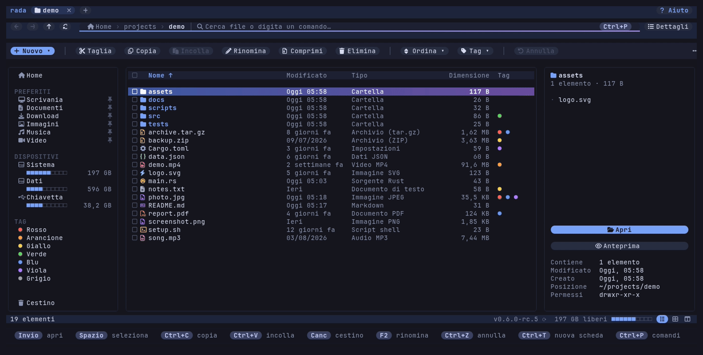
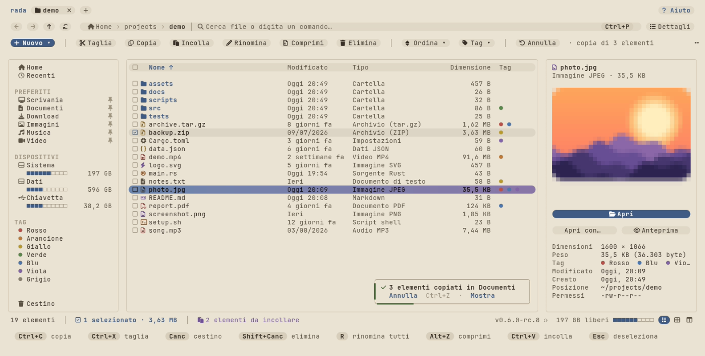
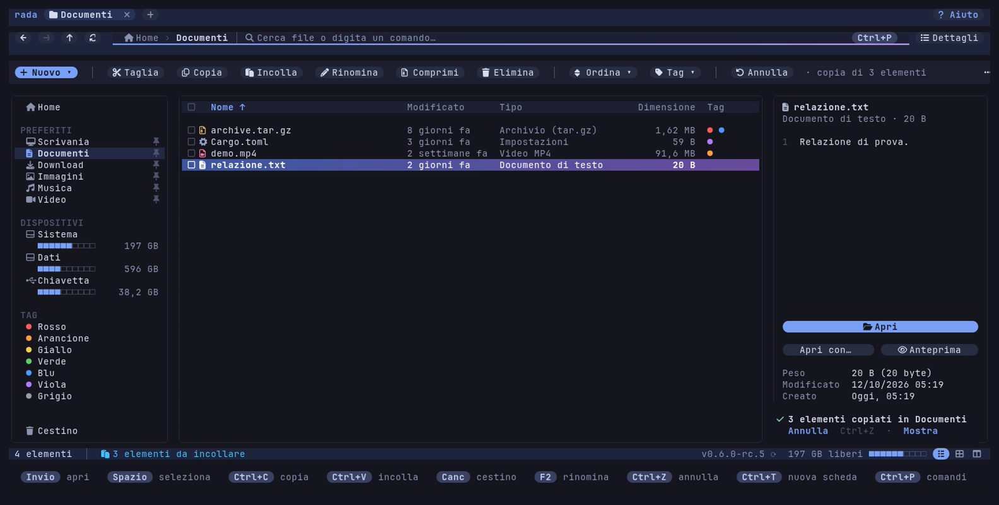

# rada



**A safe harbor for your files.**

rada is a fast file manager for the terminal, written in Rust, driven by keyboard or mouse. It is built around three promises:

1. **Plan first.** Every operation on files shows a *plan* before anything is touched: what will be done, how many files and bytes, and warnings about symlinks, permissions and name conflicts. You confirm, or you don't.
2. **Undo always.** Every operation that finishes is recorded in a persistent journal and can be undone, even after a restart or a crash. If a file was modified after the operation, undo leaves it alone and tells you, instead of overwriting it.
3. **Robust by construction.** Progress is counted in bytes. A failure on one file never stops the rest: you choose to skip, retry or abort, and the message always carries the full path. Symlinks stay symlinks (even broken or circular ones), nothing follows a link out of the tree, and a half-written file never appears under its final name.

## The look


Three items are selected, two wait on the clipboard, the cursor is on a picture, and the card at the bottom right says the last copy went through, with **Annulla** and **Mostra** one click away. On a light terminal the same screen is "Carta", the paper theme:



The interface speaks **Italian and English** (the screenshots are in Italian); it follows the system, or `language = "it"` / `"en"`. Everything is drawn with soft shapes — rounded cards, pills, a shade behind the cursor — where the terminal's font has the glyphs for them, and plainly where it has not (see [Terminals](#terminals)).

| | |
|---|---|
|  |  |
| The **Icons** view: a big icon and the name. | The **Columns** view, as in the Finder: the folder above, the folder here, what is under the cursor; `←` and `→` move between the columns. |
|  |  |
| The menu of the right button, with each action's key. | **Apri con…** lists the programs that can open the file. |
|  |  |
| The **TAG** section of the sidebar and the list of what carries one (*Tag: Blu*). | After a copy, a move, the trash, a rename, a compression, an extraction or a change of tags, a card says what was done, with **Annulla** and **Mostra**. |
|  |  |
| Every operation shows a **plan** first. | Progress counted in bytes, with throughput and time left. |
|  |  |
| The **basic profile** (`TERM=vt100`): ASCII, 16 colours, `[######----]` for a disk. | A narrow terminal: the sidebar is a column of icons. |

## Status

Version 0.6.0-rc.5. **Linux is supported.** Windows and macOS are a **pre-release**: the Recycle Bin / Trash, drives and volumes, the standard folders, opening files, and — new in this release — the things people expect of the Finder and Explorer (packages, localized names, ejecting, Quick Look, tags on macOS; localized names and ejecting on Windows) are implemented, and the whole test suite runs on all three systems in CI. The Mac version has had its first real-world try-out; nobody lives in the Windows one yet, so expect rough edges, and the parts of a copy that preserve attributes (ACLs, alternate data streams, resource forks, and the extended attributes other than tags) are not done there: the plan says so before anything is copied.

rada is young and written by one person. The parts that touch your files — planning, copying, the journal, undo — are covered by unit tests, fault-injection tests (full disk, revoked rights, files that change or vanish), tests that kill the process with `SIGKILL` in the middle of an operation, and property tests that generate random trees and check that copy → undo and move → undo give back exactly the starting state, and that compress → extract gives back the same tree. That is a lot more than nothing and much less than years of use. Read [what is guaranteed and what is not](docs/SAFETY.md), keep backups of what matters, and please report anything strange. Review of the operations engine by other people is the help the project needs most ([CONTRIBUTING.md](CONTRIBUTING.md)).

## Why it is different

| | |
|---|---|
| **Looks like what you know, softer** | Tabs on top, **one bar** (the path as clickable crumbs and *Cerca file o digita un comando…* in a single pill; `Ctrl+P`, `Ctrl+L` or `Ctrl+F` start typing: a path is completed, words filter the files and offer the commands that match), a command bar (New, Cut, Copy, Paste, Rename, Compress, Delete, Sort, Tags and *Undo · copy of 3 items*), a navigation pane (Home, pinned folders, disks as ten segments, tags, Trash), the folder as a table with a **Tag column**, as a grid of icons or as **columns** like the Finder's, a details pane with a big preview whose corners are rounded, a status bar and a row of key hints. The three panels are rounded cards; buttons, the tab in front, key chips and column titles are pills; the row under the cursor is shaded and has rounded ends. A **card** at the bottom right says what an operation did, with *Undo* and *Show*, and goes by itself. It adapts to the terminal: below 140 columns the details pane steps aside, below 100 the buttons lose their words and the Type column goes, below 60 only name and size remain; on a short terminal the hints go first, then the command bar. Names with CJK, emoji or very long text stay aligned and are cut with `…`. |
| **In your language** | Every text of the interface, the plan window and its warnings, the journal, the Type column ("Immagine JPEG"), dates ("3 giorni fa", "Oggi 15:21"), sizes (`70,7 KB`) and the key names are in Italian or English, from one table; the system decides, or `language = "it" \| "en"`. |
| **Keyboard *and* mouse** | Vim keys and the usual desktop shortcuts work together by default (`y` or `Ctrl+C`, `d` or `Del`, `u` or `Ctrl+Z`…). The mouse selects, opens, scrolls, sorts by column, goes back and forward, picks places in the sidebar, and a right click opens a context menu that shows each shortcut. Every key can be rebound. |
| **Plan window** | Copy, move, rename, bulk rename, new folder, trash, delete: all show a plan with totals and warnings first. Permanent deletion states clearly that it cannot be undone and asks you to type `yes`. |
| **Journal + undo** | `u` undoes the last operation (with its own plan, so you see what undo will do). `U` shows the history. Undo of a copy removes exactly what the copy created; undo of a move moves back; undo of trash restores from the trash; undo of an overwrite brings the old file back. |
| **Per-file errors** | One unreadable file does not abort a 10,000-file copy. Errors are handled per step: skip / skip all / retry / abort. |
| **Byte progress** | A real progress bar with throughput and ETA, not "3 of 4 items". |
| **Faithful copies** | A copy keeps permissions (including setuid/setgid/sticky), times, extended attributes, POSIX ACLs, owner and group when the system allows, hard links between the files you copy together, and the holes of sparse files (progress counts real bytes). Before you confirm, the plan lists what the destination cannot hold (a FAT drive has no owners or ACLs); afterwards the result window lists anything that could not be kept. |
| **Survives a crash** | Every journal record reaches the operating system as it is written. If rada is killed in the middle of an operation, the next start removes the half-written file, keeps both copies of a move that was cut, and tells you; undo still works. See [docs/SAFETY.md](docs/SAFETY.md). |
| **Safe across filesystems** | Moves between filesystems are copy → verify (checksum of what was written) → remove source, file by file; the source is never deleted for something that failed to copy. Trashing follows the freedesktop.org specification, including per-device trash directories. |
| **Live** | The folder view updates by itself (inotify via `notify`), with debouncing. Sorting is stable and deterministic and applies instantly. |
| **Nothing blocks the UI** | All I/O happens in worker threads; the interface thread only draws and handles keys. Volumes are listed by a worker, never on a keypress, with a timeout per mount so a hung network share cannot freeze anything. |
| **Real image previews** | PNG, JPEG (with EXIF rotation), GIF (first frame), WebP, BMP and SVG are drawn with the best protocol the terminal offers: Kitty graphics (Ghostty, kitty), iTerm2 images (WezTerm, iTerm2), Sixel (foot), or coloured half blocks everywhere else. Decoding and resizing run in worker threads, so browsing a folder of photos never delays a keypress. Below the picture: format, pixel size, weight and date. Images that are too big are refused from the header alone, with a clear message. |
| **PDF and document previews** | The first page of a PDF is drawn like an image, with page count, title and author below it — with **no program to install on macOS and Windows** (macOS draws it with `sips`, Windows with its own PDF renderer). On Linux poppler (`pdftoppm`; `pdftotext` for a text fallback) does it, and when it is missing the message gives the install command for your distribution. On macOS Quick Look draws Office documents, Pages, Numbers, Keynote, RTF and videos (the picture the Finder shows); on Windows the shell's thumbnails do, when Windows has a handler for the type. Password-protected and damaged files say so. Drawing runs in a worker with a time limit and is stopped the moment you move to another file; pages are cached in the cache folder and pruned by age and size. |
| **Archives** | `Enter` on a zip, tar (`.gz` `.bz2` `.xz` `.zst`), 7z or RAR opens it like a read-only folder; the path reads `photos.zip › 2024`, and text and pictures inside are previewed. Extract here or into a folder, or compress a selection, always with a plan, byte progress, cancel and undo. Paths that climb out of the destination, links that lead out, password-protected files and decompression bombs are stopped or confirmed first. See [Archives](#archives). |
| **Real disks only** | The sidebar lists real disks, partitions, removable drives and network shares, not `tmpfs`, `proc`, `binderfs`, snap loops, bind-mount duplicates or `/boot/efi`. The list is configurable (`[devices] hide`). |
| **Binary files get a card** | Instead of a wall of hex: file type, size, dates, permissions and, for executables, the architecture (ELF, PE and Mach-O are read from the header, never run). The hex dump is one key away (`H`). |
| **Hostile names are harmless** | Newlines, escape sequences, bidi controls and invalid UTF-8 in file names are shown as visible escapes. Paths are `Path`/`OsString` everywhere, never text. |


## Download

Binaries for Linux (static, x86_64 and aarch64), Windows (x86_64) and macOS (Intel and Apple silicon) are on the [releases page](https://github.com/formikadesk/rada-fm/releases), with a `SHA256SUMS` file. Unpack the archive and put `rada` (`rada.exe`) somewhere on your `PATH` (on a Mac, `~/.local/bin` or `/usr/local/bin` will do; no Homebrew is needed). Once it is installed, rada can [update itself](#updates).

Windows and macOS builds are new: please report anything odd in an issue.

### On a Mac

- **Use [Ghostty](https://ghostty.org)** if you can: rada draws pictures with the kitty graphics protocol, the icons work with no font to install (Ghostty ships a Nerd Font symbols fallback, which rada detects), and Ghostty passes the Cmd key on (see [macOS](#macos)). iTerm2, WezTerm, kitty and Terminal also work, with less.
- **Allow your terminal to see your folders.** macOS asks before a program may read the Desktop, Documents, Downloads, iCloud Drive or an external disk, once per terminal. If you said no — or a folder just shows "Operation not permitted" — rada says "macOS has not given *Ghostty* access to *Documents*" and a button opens *System Settings → Privacy & Security → Files & Folders* for you; switch the terminal on there, or give it *Full Disk Access* to cover everything. Then quit the terminal and start it again.
- `rada setup desktop` makes **Rada.app** in `~/Applications`: a click opens rada in Ghostty (iTerm2 or Terminal if that is not installed). See [Desktop integration](#desktop-integration).

## Install

From source. You need a Rust toolchain of version 1.90 or newer ([rustup](https://rustup.rs)).

```sh
git clone https://github.com/formikadesk/rada-fm rada
cd rada
cargo install --path crates/rada
```

Or just build it: `cargo build --release` and use `target/release/rada`.

A [Nerd Font](https://www.nerdfonts.com/) in your terminal is recommended: rada then shows file-type icons. It looks for the font in the configuration of Ghostty, kitty, WezTerm, Alacritty, foot, Windows Terminal and Konsole; otherwise it uses Unicode markers, chosen for what the fonts of the system can draw (`--icons nerd|unicode-icons|unicode-std|none` overrides; see [Terminals](#terminals)).

Optional: make your shell follow rada's last folder (`v` instead of `rada`):

```sh
eval "$(rada --init bash)"        # also: zsh, fish, nushell, powershell
```

Optional: add rada to your application menu (Linux), the Applications folder (macOS) or the Start menu (Windows) — see [Desktop integration](#desktop-integration) — and install a font for the icons with `rada setup font`.

## First steps

```sh
rada                 # open the current folder
rada ~/Pictures      # open a folder
rada photo.png       # open its folder with the cursor on the file
```

Move with `j` `k` or the arrow keys, open with `Enter`, go up with `Backspace` (`Alt+↑` anywhere). Press `?` (or `F1`) for the full list of keys, `Ctrl+P` to jump to any folder, bookmark or disk. `Alt+←` and `Alt+→` go back and forward like in a browser; `Tab` moves into the sidebar of places. Select with `Space`, then copy (`Ctrl+C`), move to another folder and paste (`Ctrl+V`): a **plan** appears first, and nothing happens until you press `Enter`. Changed your mind afterwards? `Ctrl+Z` undoes it.

## Usage

```sh
rada [PATH] [--icons nerd|unicode|none] [--theme NAME] [--appearance auto|light|dark] [--keymap PRESET] [--no-mouse] [--hidden]
```

Icons default to plain Unicode markers. With a [Nerd Font](https://www.nerdfonts.com/) installed, use `--icons nerd` (or `icons = "nerd"` in the config file).

Open a file instead of a folder (`rada photo.png`) and rada starts in its folder with the cursor on it.

### Images

`--images auto` (the default) picks the protocol like this: under tmux, half blocks (graphics queries are only answered with `allow-passthrough`, and waiting for them would be slow); in a terminal that identifies itself (Ghostty, kitty, WezTerm, iTerm2, foot), the matching protocol with no query at all; otherwise the terminal is asked, with a bounded wait. Force a protocol with `--images kitty|sixel|iterm2|halfblocks`, or switch image drawing off with `--images off` (then nothing is decoded). Under tmux with passthrough enabled, `--images kitty` works too.

Large images: anything above 50 megapixels or 128 MiB is not decoded (a 12000×12000 PNG is refused instantly, from its header). Both limits are configurable.

Optional config: `$XDG_CONFIG_HOME/rada/config.toml`

```toml
profile = "auto"      # auto | modern | basic: see "Terminals"
icons = "auto"        # auto | nerd | unicode-icons | unicode-std | none: see "Terminals"
theme = "auto"        # auto | rada | catppuccin | tokyo-night (follow the terminal), or a fixed
                      # rada-dark | rada-light | catppuccin-mocha | catppuccin-latte | tokyo-night-dark | tokyo-night-day
                      # | nebbia-light
appearance = "auto"   # auto | light | dark: which variant a theme name takes
show_hidden = false
sort = "name"         # name | size | date
reverse = false
bookmarks = ["~/projects", "/mnt/data"]
images = "auto"       # auto | halfblocks | kitty | sixel | iterm2 | off
image_max_megapixels = 50
image_max_file_mb = 128
pdf_max_file_mb = 512     # larger PDFs are not drawn
pdf_timeout_seconds = 8   # a PDF that takes longer to draw is given up on
mouse = true          # false: rada never captures the mouse
sidebar = true        # the navigation pane; Ctrl+B toggles it and remembers
show_hints = true     # false: no row of key hints at the bottom (`hints` is the older name)
layout = "explorer"   # explorer | compact (no bar, command bar or hints: the most room)
show_details_pane = true  # false: never show the details pane by itself (Alt+P still does)
view = "details"      # details | icons | columns: how a new tab shows a folder
tags_column = true    # the coloured dots of the tags in their own column of the Details view
language = "auto"     # auto (from the system) | it | en
remember_tabs = true  # reopen the tabs of the last session
dates = "relative"    # relative ("Today 14:03", "3 days ago") | absolute (dd/mm/yyyy hh:mm, in the order of your locale)
folder_sizes = "auto" # auto: count the size of the folders you can see, in the background | items: only how many items each holds | off
folder_size_seconds = 3   # one count gives up after this long and shows "> size"
folder_size_entries = 200000  # ...or after this many files and folders
keymap = "vim+classic"   # vim+classic (default) | vim | classic
natural_sort = true   # file2 before file10, capitals and small letters mixed (as the Finder and Explorer do)
cmd_keys = true       # macOS: ask the terminal to report the Cmd key, for Cmd+C/V/X and friends

[archives]
max_extract_gb = 8        # an extraction that would write more asks for a typed "yes"
max_ratio = 200           # ...and so does one that unpacks this many times its size

[update]
check = true              # look for a newer rada, at most once a day, in the background
channel = "auto"          # auto | stable | prerelease (see Updates)
method = "auto"           # auto | binary | source | package
source_dir = "~/rada-fm"  # the git checkout the `source` method updates

[devices]
hide = ["tmpfs", "fuse.*", "/boot", "/boot/*"]   # replaces the built-in list of mounts kept out of the
                      # disks: a name is a filesystem type (`fuse.*` a prefix), `/path` a mount point,
                      # `/path/*` it and everything below

[keys]                # per action; replaces all of its keys, [] unbinds it
copy = ["y", "ctrl+c"]
trash = ["d", "delete"]
quit = "ctrl+q"
```

State lives in `$XDG_STATE_HOME/rada/` (`journal.jsonl`, `log/`, and `ui.json` with the tabs that were open, whether you hid the navigation pane or the details pane, and the view of each tab); the PDF page cache is in `$XDG_CACHE_HOME/rada/previews`. Set `RADA_LOG=debug` for more logging (written to a file, never to the screen).

## Archives

`Enter` on an archive opens it like a folder, read-only. What counts as an archive is decided by the **content**, not the name: a zip called `backup.dat` opens, a `.docx` (which is a zip inside) opens in your word processor. Supported to read and extract:

| Format | How |
|---|---|
| zip, tar, `.tar.gz` `.tgz`, `.tar.bz2`, `.tar.xz`, `.tar.zst`, and single files `.gz` `.bz2` `.xz` `.zst` | built in, the same on every platform (zstd uses the bundled official library, everything else is pure Rust) |
| 7z | built in (not password-protected ones) |
| RAR | through `7z`/`7zz` or `unrar`, if installed (the licence does not allow including a RAR decoder); without one rada says so and how to install it |

Inside an archive you navigate, filter and sort as in any folder; the breadcrumb reads `archive.zip › folder`. Selecting an archive (without opening it) shows its format, how many files and folders, packed and unpacked size, and the first items. Text and pictures inside are previewed (taken out into the preview cache, with size limits). Rename, move, delete and new folder are refused in an archive; **copy** items out (`Ctrl+C`, then `Ctrl+V` in a folder) and that is a partial extraction with its own plan.

| Action | Vim | Classic | Menu |
|---|---|---|---|
| extract here | `e` | `Ctrl+E` | right-click an archive → *Extract here* |
| extract into a folder named after the archive (you can change the name) | `E` | `Alt+E` | *Extract to a folder…* |
| compress the selection (name and format; `Tab` changes the format) | `z` | `Alt+Z` | *Compress…* |

The folder is named from the archive's **file name** only (`photos.tar.gz` → `photos/`; a dot in a folder above never matters). If the archive already has a single folder at its top, no second one is made around it. The plan shows files, folders, links, total size, free space, name conflicts (skip / keep both / overwrite, with the old file going to the trash so undo brings it back) and the safety findings below, each with its reason.

- **Paths that would leave the destination** (`..`, absolute, drive letters, a `\` that climbs out) are not extracted, and the plan counts them. Nothing is written through a link that the archive itself made.
- **Links** are created as links and never followed; if one points outside the extracted folder the plan says so.
- **Bombs**: an extraction above 8 GiB or above 200× its packed size asks for a typed `yes`. Whatever the list says, a member can never write more than the archive declared for it. Limits are in `[archives]`.
- **Password-protected** zip and 7z are recognised and said so; passwords are not supported yet.
- **Old zip names** (code page 437) are decoded correctly; names that are not text are kept as they are.
- Extraction writes every file under a temporary name and renames it when complete, counts progress in real bytes, can be cancelled (what was made is removed) and undone (exactly what was extracted; a file you edited is left alone). A `SIGKILL` in the middle leaves no half file and the next start cleans up. Setuid/setgid bits are dropped from extracted files.
- **Compress** makes zip, `.tar.gz`, `.tar.zst` or `.tar.xz` with contents, permissions, times and symlinks (zip stores them as links; the plan warns that some programs, Windows Explorer for one, extract those as small files). The estimated size comes with the plan; cancelling removes the half-written archive, undo removes the finished one.

```toml
[archives]
max_extract_gb = 8      # an extraction that would write more asks for a typed "yes"
max_ratio = 200         # ...and so does one that unpacks this many times its size
preview_entries = 200   # items listed in the preview of an archive
preview_seconds = 1.5   # how long counting an archive's members may take in the preview
```

What is guaranteed, and what is not (RAR tested with 7-Zip and a stand-in, no owner or ACLs in archives you create…), is in [docs/SAFETY.md](docs/SAFETY.md).

## Updates

rada looks for a newer version **at most once a day**, in a background worker that never slows the start. It reads GitHub's public list of releases and sends nothing but `User-Agent: rada/<version>`; a network error is silent. A stable version only sees stable releases; a pre-release (`0.6.0-rc.5`) also sees later pre-releases (`channel = "stable"` or `"prerelease"` decides by hand, `check = false` turns the background check off).

When one exists you see it twice: a pill in the accent colour in the tab bar, **↑ Update to X**, and the status bar, **New version X available — press Alt+U to update** (click either). `U` is the history of operations in the vim keys, so the update has `Alt+U`. A window shows the release notes first; `Enter` updates, `Esc` leaves it for later.

The status bar always shows the version that is running, **v0.6.0-rc.5 ⟳**: a click asks the network right away (whatever the day's check said) and answers *rada is up to date* or opens the notes. The **Help ▾** button of the tab bar is a menu with the keys, *Check for updates* and *About rada* (the version, the channel it follows, how it would be updated and where the program is). From the command line:

```sh
rada update --check     # only say whether a newer version exists, and what is in it
rada update             # show the notes, ask, update
rada update --rollback  # go back to the version that was running before
```

How it updates depends on how this copy got here (`method = "auto"`, or choose):

| | |
|---|---|
| **binary** — downloaded from the releases | downloads the archive for this system and processor (Intel or Apple silicon on a Mac; under Rosetta, the native one), checks it against the release's `SHA256SUMS`, starts the new program once with `--version`, then replaces the running one atomically (on Windows the running file is renamed out of the way first). The old one is kept for `--rollback`. A file rada writes has no macOS quarantine flag; rada checks and clears it anyway. |
| **source** — built from a git checkout (`source_dir`, or the checkout the program sits in) | in that folder: stops with an explanation unless the working tree is clean and the branch is `main`; `git pull --ff-only`; `cargo build --release --locked`; puts the new program in place of the running one; `cargo clean`. Progress shows in the status bar, the interface stays usable, and if a step fails the old program is untouched and the log (`$XDG_STATE_HOME/rada/update/last.log`) can be opened from the window. |
| **package** — installed by a package manager (a system path, the AUR, Scoop, Homebrew) | touches nothing and says which tool to use. |

## macOS

What a Mac user expects of a file manager, as far as a terminal allows:

- **Permissions.** When macOS refuses a folder until you allow it, rada says so in words and opens the right page of System Settings (see [On a Mac](#on-a-mac)); the sidebar marks the folders that are waiting.
- **Packages.** `.app`, `.bundle`, `.framework`, `.photoslibrary`, `.pages`, `.numbers`, `.key`, `.rtfd` and every folder the system treats as a package (asked of Launch Services, with the Finder's bundle bit as a second opinion — not guessed from the name) behave like files: `Enter` opens them with their program, they sort among the files, and the right-click menu has *Show package contents* (`Alt+↓`) to go inside.
- **Hidden like in the Finder.** `.DS_Store`, `._*` files, `.localized` and every folder flagged hidden (`~/Library`) stay out of sight until you show hidden files (`.`, or `Cmd+Shift+.`).
- **Names as the Finder shows them.** The sidebar and the breadcrumbs say *Scrivania*, *Documenti*, *Macintosh HD*, the way your language has them; **Properties** and **Copy path** still give the real path.
- **Natural order** everywhere: `file2` before `file10`, capitals mixed with small letters (`natural_sort = false` for letter by letter).
- **Eject** in the right-click menu of a disk and with `Del` on it in the sidebar: a confirmation, then `diskutil eject`; a busy disk says who is using it ("Finder (process 412)…") and can be tried again. **iCloud Drive** is in the sidebar when it is there.
- **Quick Look**: *Quick Look* in the item's menu, a button under *Preview* in the details pane, `Alt+Y` (and `Cmd+Y`), and `Q` in the full-screen preview. `Space` still means *select*.
- **Previews without poppler**: PDFs, Office documents, Pages, Numbers, Keynote, RTF and videos, see above.
- **Tags**: the Finder's own, see [Tags](#tags).

**The Cmd key.** On a Mac, rada's classic scheme also answers `Cmd+C`, `Cmd+V`, `Cmd+X`, `Cmd+Backspace` (to the trash), `Cmd+I` (properties), `Cmd+O` (open), `Cmd+↑` (parent), `Cmd+[` and `Cmd+]` (back and forward), `Cmd+Shift+.` (hidden files), `Cmd+Z` / `Cmd+Shift+Z`, `Cmd+Y` (Quick Look), `Cmd+A` and `Cmd+Shift+N`. Two things must be true for that, and rada only controls the first:

1. *The terminal reports the Cmd key.* That is the kitty keyboard protocol: **Ghostty**, kitty and WezTerm (with `enable_kitty_keyboard = true`) and iTerm2 (with "Report keys using CSI u" on) do; **Terminal.app does not**. rada asks for it on a Mac (`cmd_keys = false` stops that) and shows `Cmd+…` in its hints only when the terminal answered.
2. *The terminal does not keep the key for itself.* Ghostty binds `Cmd+C`, `Cmd+V`, `Cmd+Z`, `Cmd+Shift+Z`, `Cmd+A`, `Cmd+Backspace`, `Cmd+↑`, `Cmd+[` and `Cmd+]` (checked against its source; the others rada uses are free). In the window `Rada.app` opens, a settings file frees them with `keybind = super+c=unbind` and so on. In **your own** Ghostty window those keys still belong to Ghostty until you add the same lines to your config (`~/Library/Application Support/com.mitchellh.ghostty/config`; the list is in `Rada.app/Contents/Resources/rada-ghostty.conf`). The Ctrl keys work everywhere.

Things that do **not** work: `Cmd+Q`, `Cmd+W`, `Cmd+T`, `Cmd+N` and the rest of the terminal's own shortcuts stay the terminal's; the Dock shows the terminal's icon; Finder-style drag and drop and "Put Back" from the trash are not there; ACLs, resource forks and extended attributes other than tags are not carried over by a copy.

## Windows

- **Names as Explorer shows them.** The sidebar and the breadcrumbs use the shell's display names for the Known Folders and the drives ("Documenti", "Disco locale (C:)"), not the names on disk; the real path stays in Properties and *Copy path*.
- **Eject** for removable drives (the right-click menu, `Del` in the sidebar): rada locks the volume — it fails with "a program still has a file open" if one does —, dismounts it and asks the drive to release the media, all without administrator rights. Fixed disks and network drives have no such entry.
- **PDF previews** use Windows' own renderer (`Windows.Data.Pdf`, Windows 10 and later) and other documents the shell's thumbnails, when Windows has a handler for the type. No program to install. The choice of the system renderer over a bundled one is explained in the [changelog](CHANGELOG.md).
- **Not supported**: tags (the menu entry is absent), ACLs and alternate data streams in copies.

## Tags

The Finder's tags on macOS (the extended attribute `com.apple.metadata:_kMDItemUserTags`, with the seven standard colours), and `user.xdg.tags` on Linux (the convention Dolphin and Baloo use: tag names separated by commas, no colours; a tag called "Red" is drawn red). Windows has no tags and offers nothing.

- **See them**: coloured dots after the name in the Details view and under the name in the Icons view (three at most, then `+2` for two more), and a *Tags* row in the details pane.
- **The TAGS section of the navigation pane** always lists the seven colours, in the Finder's order and called what your system calls them (*Rosso, Arancione, Giallo, Verde, Blu, Viola, Grigio* on an Italian Mac), then the tags of your own that rada has seen on the items of the folders you opened in this session. Clicking one opens **Tag: Blu**: everything that carries it, wherever it is (Spotlight on a Mac; Baloo's `baloosearch` on Linux; when neither has anything to say, a walk of your home folder in the background that skips hidden folders and gives up after 30 seconds or half a million items; none on Windows). Each row says which folder the item is in. The list takes the operations of any list of items — open, copy, cut, rename, trash, tags, properties, compress, *Open with…* — and refuses what would make something *in* it (new folder or file, paste); `Up` goes back where you came from. A colour matches the tags of that colour under any of its names (a *Blue* made on an English machine is in *Blu*), but not a tag of your own that happens to be blue.
- **The Finder's number is the colour.** The seven colours are written as the Finder writes them (`Blu` and `4`; a tag with none as `Lavoro` and `0`), and read back from the number, never from the name.
- **Change them**: the right-click menu has *Tags ▸* with the seven colours, the other tags the selected items already carry, *New tag…* and *Remove all tags*. A tag is ticked when every selected item has it, and choosing it takes it off from all; otherwise it is given to all. It works on a selection.
- **Like everything else rada does to files**, a change of tags shows a **plan** first (what each item had and will have), is written to the **journal** and can be **undone** — and undo leaves tags alone that someone changed after the operation. In the JSON requests it is `set_tags`.
- **Copies and moves keep them** (on macOS only the tags are carried over: the rest of the extended attributes is not done yet, and the plan still says so).
- **Find them**: type `tag:red` (or any part of a tag's name, or `tag:` alone for "anything tagged") in the bar; other words still match names.

## The screen

From the top: a row of **tabs**, the **bar**, the **command bar**, then the body — three rounded cards: the **navigation pane**, the folder, the **details pane** — a **status bar** and a row of **key hints**. Everything drawn as a button does what its key does, through the same path: a plan first, then your confirmation, then the operation.

### Tabs

`Ctrl+T` opens a tab in the current folder, `Ctrl+W` closes it (the last one is not closed: it goes back to Home), `Ctrl+Tab` / `Ctrl+Shift+Tab` or `Ctrl+PgDn` / `Ctrl+PgUp` switch, `Alt+1` … `Alt+9` jump, a click on a tab switches and a middle click (or its ✕) closes it. Each tab has its own folder, history, cursor, selection, sort order and view; the clipboard, the journal and undo are shared. The open tabs are remembered between sessions (`remember_tabs = false` turns that off); a folder given on the command line opens in a tab of its own beside them. On a narrow terminal the tabs fold into `‹ 2/3 ›`.

### The bar

One pill holds the path and the search. At rest it shows the path as clickable crumbs (`…` folds a long one; click it to pick a hidden folder) and *Cerca file o digita un comando…* with a **Ctrl+P** chip; under it a thin line fades from one accent to the other. At the left sit back `‹`, forward `›`, up `↑` and refresh `⟳` (`Alt+←`, `Alt+→`, `Alt+↑`, `F5`; `Backspace` goes back with the classic keys alone and to the parent with the vim keys), at the right the pill of the view (*Colonne*, *Dettagli*, *Icone*).

`Ctrl+P` (`m` in the vim keys), `Ctrl+L`, `Alt+D`, `F4`, `Ctrl+F`, `/` or a click on the pill start typing, and what you type decides what happens:

- a **path** (`~/Documenti`, `/etc`, `../x`): `~` is your home, relative paths start at the current folder, `Tab` completes with the subfolders (listed by a background worker, never while you type), `Enter` goes. `Ctrl+L` selects the old path, so typing replaces it;
- **words**: the files of this folder are filtered as you type (`tag:red` finds by tag), and under the bar the **commands** that match (*Copia*, *Nuova cartella*, *Vista a colonne*…) and the places (folders, recents, pinned, disks) are offered. `↑` `↓` choose, `Enter` runs the one chosen; with none chosen it keeps the filter if files match, otherwise it runs the best command;
- `Esc` goes back to the path and clears the filter; `Backspace` on an empty bar closes it.

### Command bar

**+ New ▾** (a folder or an empty file), **Cut, Copy, Paste, Rename, Compress, Delete**, **Sort ▾**, **Tags ▾** (where the system has tags) and **Undo · copy of 3 items**, which says what the next undo would undo (taken from the journal). A button that cannot be used right now is faint and does nothing. Below 100 columns only the icons stay; the **⋯** at the right has the rest.

### The folder

**Details** shows a checkbox, the icon and name (folders in the accent colour and bold), the date, the type in words and the size; the column titles sort (click again to reverse, an arrow marks the sorted one). A click on a name moves the cursor; the box on the left, or `Space`, selects; double-click or `Enter` opens. The row under the cursor has a shade that goes from one accent to the other, white bold text and rounded ends (on a terminal without true colour or without a Nerd Font it is a solid colour); selected rows have a quiet background, a ticked box and a bold name. The **Tag** column shows the dots of the tags (three at most, then `+2`); *Vista ▾* or `F8` hides it, and it goes by itself when the name would get too little room. Dates are relative ("Today 14:03", "Yesterday", "3 days ago", "2 weeks ago", then the full date in the order your locale uses; `dates = "absolute"` always writes it in full). The size of a **folder** is counted in the background, only for the folders on screen (`···` while it counts, `> 3.2 GB` when it had to stop early): links, other disks, `/proc`, `/sys`, `/dev` and network shares are not entered, and `folder_sizes` (`auto`, `items`, `off`) with `folder_size_seconds` and `folder_size_entries` set how far it goes.

**Icons** shows tiles with a big icon and the name under it, cut with `…`. The arrows and `h` `j` `k` `l` move in two dimensions; selection and every action are the same. Switch with the pill of the view, the buttons at the right of the status bar, `Ctrl+1` / `Ctrl+2` / `Ctrl+3` (if your terminal tells them apart) or `v`.

**Columns** is the Finder's view: the folder above on the left, this folder in the middle, and on the right what is under the cursor (a folder's contents, or the preview of a file). `→` or `l` goes into a folder, `←` or `h` to the folder above. Under 54 columns of width it falls back to the table.

### Notifications

When a copy, a move, the trash, a rename, a compression, an extraction or a change of tags is done, a soft card appears at the bottom right: *✓ 3 elementi copiati in Documenti*, then *Annulla Ctrl+Z · Mostra*, both clickable (*Mostra* goes to the folder). It never takes the focus: the first key you press goes to the list, and the card goes with it, or by itself after about six seconds. Cards that come one after the other wait their turn. An **error** stays, in the error colours, until you close it with `Esc` or a click.

### Details pane

The name with its icon, the type and size, a big preview (pictures, a PDF's first page, text, an archive's contents), then **Open** (full width), **Open with…** and **Preview** (the preview over the whole screen), then the properties: *Dimensions* for pictures, *Size* with the exact bytes, *Modified*, *Created* where the file system keeps it, *Location* and *Permissions*. It is a column from 140 columns; below that `Alt+P` shows it over the right of the list. `Alt+P` toggles it and the choice is remembered.

### Navigation pane

**Home**, then **PINNED** (your standard folders under the names your system really uses — *Scaricati* and *Documenti* on an Italian desktop — and the folders you pin, marked with a pin), **DEVICES** (each disk with a bar of ten segments, `■■■■■■□□□□`, of how full it is, and what is free; `[######----]` in the basic profile), **TAGS** (the colours and your own tags) and the **Trash**. Pin a folder from the context menu or with `B`; `Del` on a pinned folder (with the keyboard focus on it) unpins it. The folders pinned in the config file (`bookmarks`) can only be unpinned there. The place you are in has a quiet background. `Tab` moves the keyboard into the pane (`↑` `↓`, `Enter` opens, `Tab` or `Esc` leaves). `Ctrl+B` shows or hides it. Below 100 columns it becomes a column of icons (hover or move onto one and its name shows in the status bar), below 60 it goes.

### Status bar and hints

`19 elementi │ ☑ 3 selezionati · 56,7 MB │ ⎘ 2 elementi da incollare` on the left (the screenshots are in Italian; in English, `19 items │ ☑ 3 selected · 56.7 MB │ ⎘ 2 items ready to paste`); on the right the free space of the current disk as a bar of segments and the buttons of the three views. Under it the **hints**: the keys that make sense now, drawn as pills and generated from your real keymap, so they follow `keymap = "vim"` and whatever you rebound. `show_hints = false` hides them; on a short terminal they go first, then the command bar.

### Open with…

`Alt+O` (`O` in the vim keys), the button of the details pane or the context menu. The window lists the **programs installed on the system that can open this kind of file**: the system's choice first (marked *default*), the programs you used lately after it, then the others by name. Type to filter by the words of the name; `↑` `↓` and `Enter` (or a click) start the highlighted one. The last line, **Other program…**, is the free field of a command with its options (`code`, `vlc --fullscreen`; on a Mac an application's name), filled with what you had typed.

- **Linux**: the `.desktop` files of `$XDG_DATA_HOME/applications` and `$XDG_DATA_DIRS` whose `MimeType` fits the file's type (from the shared MIME database, the types it is a kind of included: a Rust file is also a text file) and what `mimeinfo.cache` and `mimeapps.list` add; the default is the one `mimeapps.list` names; hidden entries and those whose program is not installed are left out. A program starts with its `Exec` line, the field codes (`%f %F %u %U %i %c %k`) filled in, in a terminal if it says `Terminal=true`.
- **macOS**: the applications Launch Services knows for the file (asked through `osascript`), the default first; they start with `open -a`.
- **Windows**: the programs the shell associates with the extension (what Explorer's *Open with* lists); they start through the shell, like a double click on that choice.
- **Always use this for this kind of file** (`Tab`, or click the box): rada then opens files of that type with it when you press `Enter`. It is kept **in rada's own state** (`open_with.json`, with the programs used lately) and **never changes the system's defaults**; choosing the program again and unticking the box goes back.

### Context menu

Right click (or `Shift+F10`, or the Menu key). On an item: Open, Open with…, Cut, Copy, Paste, Rename, Compress…, Extract here / Extract to… on archives, Pin to navigation, Copy path, Delete, Properties. On empty space: New, Paste, Sort by, View, Refresh, Open a terminal here.

## Themes

Every colour on screen comes from a small set of named tokens (text, dim text, accent, selection, cursor row, one colour per file type, success/warning/error…). Nothing is coloured by hand elsewhere; a test reads the sources and fails if it finds a hand-written colour outside `theme.rs`, and another renders every theme and checks that each cell uses only that theme's tokens.

Three looks, each with a dark and a light variant:

| | dark | light |
|---|---|---|
| `rada` (default): calm azure on a cool neutral base | `rada-dark` | `rada-light` |
| `catppuccin` | `catppuccin-mocha` | `catppuccin-latte` |
| `tokyo-night` | `tokyo-night-dark` | `tokyo-night-day` |
| (only light) | | `nebbia-light` |

`rada-light` is "paper": a warm off-white background instead of pure white, which is easier on the eyes. `nebbia-light` ("mist") is the same idea with a cool grey-blue paper. Both paint their own background; on a 16-colour terminal the terminal's background is kept.


The light variants use the same tokens, chosen so they read on a pale background: automatic tests check the contrast of every token against the colour it is meant to sit on (7:1 for the main text, 4.5:1 for secondary text, accents, file types and statuses). Catppuccin Latte and Tokyo Night Day are deepened where the original colours are too pale to read as text.

**`theme = "auto"` is the default.** The names `auto`, `rada`, `catppuccin` and `tokyo-night` follow your terminal: rada finds out whether its background is light or dark and takes the matching variant. Name a variant (`theme = "rada-light"`) to pin it, or keep the name and set only the brightness: `appearance = "light"` / `"dark"` (`--appearance`, `RADA_APPEARANCE`). Choose with `theme = "…"` in the config, `--theme NAME` or `RADA_THEME`.

How rada finds out, cheapest and safest first, without ever taking a key from you:

1. what you set (`appearance`, `--appearance`, `RADA_APPEARANCE`);
2. the environment: `COLORFGBG`, the Linux console (always dark), Terminal.app on macOS (it follows the system appearance);
3. asking the terminal for its background colour (the standard OSC 11 query) with a 150 ms limit, before rada starts reading the keyboard. The query is followed by a request that every terminal answers, so once that answer is in, any answer to the colour question is in too and nothing can arrive late into your input. Keys you typed in that moment are replayed, not lost. rada does not ask under tmux unless `allow-passthrough` is on (then it asks through it), never under GNU screen or on a dumb terminal, and not when its input or output is not a terminal; `RADA_NO_TERM_QUERY=1` switches the question off;
4. otherwise: the dark theme.

The result will be shown by `rada doctor` when that command exists; until then it is written to the log (`RADA_LOG=info`). The Windows console is not asked in this version (it falls back to dark unless you set `appearance`).

Colours are true colour when the terminal supports it (`COLORTERM=truecolor`), fall back to the 256-colour palette, and to the 16 ANSI colours (with reverse video for the selection) on a basic terminal. The terminal's own background is left alone, so transparency and your wallpaper keep working; the bars and the sidebar use a slightly different tone of their own.

## Terminals

rada draws one interface, and decides before drawing how much to ask of the terminal. There are two profiles and nothing in between; `rada doctor` says which one was chosen and why.

**Modern** is the default wherever the terminal speaks UTF-8 and the xterm extensions every current emulator has. The four terminals that come with a system get the same interface; what only some of them offer is used where it exists and replaced where it does not:

| | Windows Terminal | Terminal.app | GNOME Terminal (VTE) | Konsole |
|---|---|---|---|---|
| Alternate screen, mouse (SGR), bracketed paste | yes | yes | yes | yes |
| UTF-8, box drawing, block elements | yes | yes | yes | yes |
| 256 colours | yes | yes | yes | yes |
| 24-bit colour | yes | from macOS 26 (*) | yes | yes |
| Sixel pictures | yes (from 1.22) | no | no (switched off in the builds) (*) | yes |
| kitty / iTerm2 pictures | no | no | no | partly |
| kitty keyboard protocol | (*) | no | no | no |
| Clipboard sequence (OSC 52) | yes | no (*) | no (*) | (*) |
| Background colour (OSC 11) | yes | yes | yes | yes |
| A Nerd Font out of the box | no | no | no | no |
| `Alt+key` delivered out of the box | yes | no (Option is not Meta unless set so) | yes | yes |

(*) from documentation and memory, not yet measured on the terminal itself.

So, in the modern profile:

- **Colours** are 24-bit where the terminal announces them (`COLORTERM`, or a terminal known to draw them), the 256-colour palette otherwise. The pixels of a picture drawn with half blocks follow the same rule.
- **Pictures** are Sixel on Windows Terminal and Konsole (and kitty graphics or iTerm2 images on the terminals that have those), coloured half blocks on Terminal.app and GNOME Terminal. `--images` overrides.
- **Icons** are the best set the terminal's font can draw, tried in this order:
  1. `nerd`: Nerd Font symbols, when the terminal's own configuration names a Nerd Font (Ghostty, kitty, WezTerm, Alacritty, foot, Windows Terminal and Konsole are looked at);
  2. `unicode-icons`: Unicode symbols (dingbats, the rarer arrows, technical marks). No default monospace font has them all, so the terminal draws them from the system's symbol font; this set is chosen when there is one: Segoe UI Symbol on Windows, Apple Symbols on macOS, DejaVu Sans, Noto Sans Symbols, Symbola, FreeFont or Unifont elsewhere;
  3. `unicode-std`: the same marks with only the 46 glyphs every monospace font has (measured: each is in both Consolas and Cascadia Mono), for a system without a symbol font and for the classic Windows console, which falls back on no other font. `✔` becomes `√`, `✖` `×`, `★` `*`, `⇅` `↕`, the spinner `| / - \`.

  `icons = "…"` (`--icons`, `RADA_ICONS`) picks one by hand; `unicode` is still accepted as the old name of `unicode-icons`.
- **Copy path** goes through the terminal where it takes the clipboard sequence, and through the system's own clipboard (`pbcopy`, `wl-copy` / `xclip` / `xsel`, `clip.exe`) where it does not.
- **Keys**: every action has a key without `Alt` and without `Ctrl+Shift`, because not every terminal delivers those. On Terminal.app, *Settings → Profiles → Keyboard → Use Option as Meta key* makes the `Alt` shortcuts work too.

**Basic** is the one fallback for everything else: `TERM` empty, `dumb`, `linux` (the console), `ansi` or a hardware terminal's name (`vt100`, `vt220`…), or a locale that names a character set other than UTF-8. It is the same interface with ASCII glyphs (`+-|` for frames, `>` `v` `~` for arrows and ellipses), the 16 ANSI colours with reverse video for the selection, no icons, no pictures, no mouse, and no question asked to the terminal. Nothing in it is negotiated, so it looks the same wherever it runs.

`profile = "modern"` or `"basic"` (`--profile`, `RADA_PROFILE`) chooses by hand; `icons`, `images`, `theme` and `mouse` still override one thing at a time. `NO_COLOR` removes colour in either profile: bold and reverse video carry the meaning.

## Keys

Both schemes are active together by default. `keymap = "vim"` or `"classic"` keeps only one. The help (`?` or `F1`) lists every action with its keys in both schemes side by side, and always reflects your own bindings.

| Action | Vim | Classic |
|---|---|---|
| move | `j` `k` | `↓` `↑` |
| open · parent folder | `l` · `h` (and `Backspace`) | `Enter` · `←` (also `→`, and `Alt+↑` in every preset; `Backspace` is *back* here) |
| top · bottom · page | `g` `G` · `Ctrl+U` `Ctrl+D` | `Home` `End` · `PgUp` `PgDn` |
| mark and move down | `Space` | `Space`, `Ctrl+Space`, `Ins` |
| select all · extend selection | | `Ctrl+A` · `Shift+↑` `Shift+↓` (`Ctrl+Shift+Home/End` to the ends) |
| clear selection, cancel the running operation, clear filter | `Esc` | `Esc` |
| copy · cut · paste (a plan comes first) | `y` `x` `p` | `Ctrl+C` `Ctrl+X` `Ctrl+V` |
| move to trash · delete permanently (type `yes`) | `d` `D` | `Del` · `Shift+Del` |
| rename · bulk rename · new folder · new file | `r` · `R` · `n` · `N` | `F2` · — · `Ctrl+Shift+N` (also `Ctrl+N`, `F7`) · `Alt+N` |
| extract here · extract into a folder · compress | `e` · `E` · `z` | `Ctrl+E` · `Alt+E` · `Alt+Z` |
| undo · redo | `u` · `Ctrl+R` | `Ctrl+Z` · `Ctrl+Y` (or `Ctrl+Shift+Z`) |
| back · forward in the folder history | `Alt+←` · `Alt+→`, or `Ctrl+O` · `Ctrl+G` (both schemes) | |
| history of operations | `U` | `F3` |
| filter this folder (in the bar) | `/` | `Ctrl+F` |
| the bar: commands, files, folders, recents, pinned, disks | `m` | `Ctrl+P` |
| edit the address · refresh | `Ctrl+L` `Alt+D` `F4` · `F5` (both schemes) | |
| properties · open with… · copy path · terminal here | `i` · `O` · `Y` · `t` | `Alt+Enter` · `Alt+O` · `Ctrl+Shift+C` · `Ctrl+Alt+T` |
| tabs: new · close · next · previous · jump | `Ctrl+T` `Ctrl+W` `Ctrl+Tab` `Ctrl+Shift+Tab` `Alt+1…9` (both schemes) | |
| details pane · Details / Icons / Columns · context menu · Tag column | `Alt+P` or `F6` · `Ctrl+1` `Ctrl+2` `Ctrl+3` or `v` · `Shift+F10` or `Menu` · `F8` | |
| sort key · reverse · hidden files | `s` `S` `.` | |
| hex dump of a binary · scroll preview | `H` · `J` `K` | |
| pin this folder (or the item in the navigation pane) · home | `B` · `~` | |
| move between list and sidebar · show / hide the sidebar | `Tab` · `Ctrl+B` (both schemes) | |
| update rada · Quick Look (macOS) · show package contents (macOS) | `Alt+U` · `Alt+Y` · `Alt+↓` (both schemes) | |
| help · quit | `?` · `q` | `F1` · `Ctrl+Q` |

**`Ctrl+C` copies and never quits**: the terminal is in raw mode, so it arrives as an ordinary key, and a stray `SIGINT` is ignored. Quit with `q` or `Ctrl+Q`; `SIGTERM` and closing the terminal end rada in an orderly way (the running operation is cancelled, the terminal is restored).

**Redo** (`Ctrl+Y`) plans the operation you just undid again, and shows the usual plan window: it is the same request run through the same engine and recorded in the same journal. Redo is available until another operation is run; permanent deletions are never redoable.

In the plan window: `Enter` runs, `c` changes how name conflicts are resolved (skip existing / keep both / overwrite, where the old file goes to the trash so undo can restore it), `Tab` switches between the summary and every step, arrows scroll, `Esc` cancels. Paths are shown relative to the source and destination folders, which are named once at the top.

### Mouse

Click a name to put the cursor there; the box on its left (or `Space`) selects; double-click opens; the wheel scrolls (a turn is three rows, or one row of tiles); `Ctrl+click` adds one item and `Shift+click` selects a range. Everything drawn as a button or a field is clickable: the tabs (middle click closes), **← → ↑ ⟳**, the path segments, the bar, every button of the command bar, a column title to sort, an item of the navigation pane (right-click for *Open* and *Pin / Unpin*), the buttons of the details pane, the Details / Icons switch, every key of the hints, a command or place offered by the bar, and the buttons of any window. `mouse = false` (or `--no-mouse`) turns it all off. While rada owns the mouse, **hold `Shift` and drag to select text** in the terminal as usual. The mouse's own back and forward buttons are not reported by the terminal library (use `Alt+←` / `Alt+→`). Drag and drop is planned for a later release.

### Keys that terminals take for themselves

Checked in Ghostty by sending each combination to a real window and reading what the program received (the probe is `cargo run --example keyprobe`):

| Combination | What happens | In rada |
|---|---|---|
| `Shift+Home`, `Shift+End` | Ghostty scrolls its own scrollback and the program never sees them | `Ctrl+Shift+Home/End` extend the selection to the ends instead |
| `Shift+PgUp/PgDn`, `Ctrl+Shift+V/A/F/P/N/T/W`, `Ctrl+T`, `Ctrl+Enter`, `Ctrl+,`, `Ctrl+±/0` | Ghostty's own tabs, search, paste, fullscreen, font size | not used |
| `Shift+↑/↓` | passed on (Ghostty only uses them to adjust a text selection that exists) | extend selection; clear a terminal selection first if it seems not to work |
| `Ctrl+H`, `Ctrl+I`, `Ctrl+M`, `Ctrl+[` | the same bytes as Backspace, Tab, Enter, Esc in most terminals | not used (`Ctrl+Backspace` arrives as `Ctrl+H`) |
| `Ctrl+/` | arrives as `Ctrl+7` | not used |
| `Ctrl+S`, `Ctrl+Q`, `Ctrl+Z` | would be flow control and job control in a normal terminal | delivered as keys (raw mode); `Ctrl+Q` quits, `Ctrl+Z` undoes |
| `Ctrl+Space` | passed on | extra mark key |
| `Alt+←`, `Alt+→`, `Alt+↑`, `Tab`, `Shift+Tab`, `Ctrl+B` | passed on, intact | back, forward, parent, switch between list and sidebar (both Tab keys), show / hide the sidebar |

Everything else rada uses (`Ctrl+C/X/V/Z/Y/A/F/L/P/N/Q/B`, `Shift+Del`, `F1`–`F3`, `F7`, `Alt+←/→/↑`, `Tab`, `Ctrl+Shift+Z`, …) arrived intact. The window manager's own bindings (Hyprland here) all use the Super key, except `Alt+Space`, `Ctrl+Alt+Del` and `Ctrl+Shift+R`, which rada does not use. Terminals that implement the kitty keyboard protocol can tell more combinations apart; rada works with what every terminal sends.

## Requests as data

Every operation can be described as data and handed to the engine, with no interface involved. The request is a JSON document (`schema/request.schema.json`, generated from the Rust types and kept current by a test); the answer is a plan (`schema/plan.schema.json`). A plan produced this way goes through exactly the same confirmation window, the same executor and the same undo journal as one built with the keyboard.

```json
{ "op": "copy", "sources": ["/home/me/photos/2024"], "destination": "/mnt/backup", "conflict": "keep_both" }
```

```sh
rada --schema request            # print the JSON Schema (also: plan)
rada --request job.json          # plan it and open the usual confirmation window (`-` reads stdin)
```

Operations: `copy`, `move`, `rename`, `bulk_rename`, `make_dir`, `make_file`, `trash`, `delete`, `extract`, `compress`, `set_tags`, `undo`. Paths must be absolute; unknown fields are refused rather than ignored. In Rust: `Engine::plan_request` (and `Jobs::plan_request` for the asynchronous version) turns an `OpRequest` into a `Plan` without touching anything; `plan_to_json` serialises it. Non-UTF-8 file names survive the round trip. Nothing runs without a confirmation: a deletion request still asks you to type `yes`.

## Desktop integration

Everything is installed for your user, nothing needs administrator rights, and nothing is done unless you ask. `rada setup desktop --remove` takes away exactly what was installed.

```sh
rada setup desktop            # launcher, icon and (where it applies) the window's own identity
rada setup desktop --desktop  # macOS and Windows: also a launcher on the Desktop
rada setup font               # download and install JetBrainsMono Nerd Font Mono for this user
```

**Linux.** `setup desktop` writes `rada.desktop` to `~/.local/share/applications` and the icon to `~/.local/share/icons/hicolor` (SVG, and PNG at 48, 128 and 256 px), updates the desktop database when `update-desktop-database` is available, and prints each file it wrote. The entry declares `StartupWMClass=com.formikadesk.rada`, and `rada --spawn-terminal` (what the entry runs) starts the terminal with that identity — `ghostty --class=`, `kitty --class`, `alacritty --class`, `wezterm start --class`, `foot --app-id` — so a bar or workspace switcher shows **rada's icon** and not the terminal's. The entry does not claim folders, so a plain setup never changes what opens them; with `--default-file-manager` it declares `inode/directory` and uses `xdg-mime` to set rada as the handler (the previous handler is remembered and `--remove` puts it back). `--spawn-terminal` chooses, in this order, `xdg-terminal-exec`, `$TERMINAL`, then the first of ghostty, kitty, foot, alacritty, wezterm, konsole, gnome-terminal, xterm. The files for packagers are in `packaging/linux/`.

**macOS.** `setup desktop` makes `~/Applications/Rada.app`, built from files only (no code to sign): an `Info.plist`, rada's icon as a real `.icns` at every size, and a small launcher that opens rada in **Ghostty** if it is installed — in a 180×45 window with its own settings, which hand the Cmd keys back to rada (see [macOS](#macos)) — else in **iTerm2**, else in **Terminal**. `--desktop` adds a link on the Desktop. **Known limits:** while rada runs, the Dock shows the terminal's icon, not rada's: a window belongs to the program that draws it. And Ghostty asks "Allow Ghostty to execute …?" when it is started with a command given with `-e`; its author keeps that question on purpose (it closed a security hole) and it cannot be switched off. Rada.app therefore does not use `-e`: the command is the `initial-command` in the settings file of its window, so it opens one window with one rada, and Ghostty has at most one question to ask per click. If it asks, choose *Allow*. Opening rada from inside a Ghostty window you already have never asks.

**Windows.** `setup desktop` puts a shortcut with rada's icon in the Start menu (`--desktop`: on the Desktop too). If Windows Terminal is installed it adds a profile "rada" as a *fragment* (`%LOCALAPPDATA%\Microsoft\Windows Terminal\Fragments\rada\`, the way Windows Terminal asks programs to add profiles, without editing your own settings) with the icon and — once the font is installed — the Nerd Font, and the shortcut opens that profile; otherwise the shortcut starts `rada.exe` itself, whose icon is built into the program, so the taskbar shows it.

**Font.** Icons need a [Nerd Font](https://www.nerdfonts.com/) in the terminal. `rada setup font` downloads **JetBrainsMono Nerd Font Mono** (Nerd Fonts v3.4.0, the four faces and the licence; every file is checked against a SHA-256 written in rada's source, and nothing is installed unless all match) and installs it for your account: `~/.local/share/fonts` and `fc-cache` on Linux, `~/Library/Fonts` on macOS, your own fonts folder and the per-user list in the registry on Windows. Then choose "JetBrainsMono Nerd Font Mono" in your terminal's font setting. The font is under the SIL Open Font License 1.1; the licence is installed beside it. At the first start where the icons would not draw, rada **offers** to do this — once, and only if you say yes. In **Ghostty** nothing is needed: its bundled symbols fallback draws the icons, and rada detects it and does not offer.

## How it is built

A Cargo workspace:

- `crates/core` — filesystem model, the plan/execute/undo engine, journal, watcher, workers, platform layer. No dependency on any interface.
- `crates/tui` — the interface (ratatui + crossterm).
- `crates/rada` — the `rada` binary.

Every operation is expressed as a list of atomic **steps** (`MakeDir`, `CopyFile`, `CopySymlink`, `ExtractFile`, `Compress`, `Rename`, `TrashItem`, `RemoveFile`, …). A step knows its own inverse, so the same machinery plans, executes, journals and undoes. Everything that depends on the operating system sits behind one `Platform` trait (trash, volumes, file attributes, opening files, path rules); the engine never branches on the OS. The trait already models what Windows needs (drive letters, NTFS junctions and reparse points, hidden/system attributes, the Recycle Bin), with a complete Linux implementation and compilable stubs for Windows and macOS.

### Tests

```sh
cargo test --workspace
```

The interface is tested headlessly with real workers on a sandboxed filesystem: every action through both key schemes, simulated mouse events (click, double click, wheel, right click, modifiers), and committed text snapshots of the screens (`crates/tui/tests/snapshots/`, pinned clock and home folder; update with `INSTA_UPDATE=always cargo test -p rada-tui --test snapshots` and review the diff).

The suite includes regression tests for real bugs found in other terminal file managers: extraction into the wrong folder when a folder above has a dot in its name, `tar.xz` and `tar.bz2` that failed without an error, folders with dots in their names, symlinks (to files, to folders, broken, circular) inside copied trees, an unreadable file in a copied folder, moving and trashing across filesystems (tmpfs ↔ disk), Unicode/emoji/special/non-UTF-8 names, and undo of every kind of operation including "modified after the operation".

Tests never touch your real folders: each one runs in a temporary sandbox with `HOME` and all `XDG_*` variables pointing into it, and a guard fingerprints your real trash, config, state and cache before the first test and fails the test if anything under them changed.

CI (GitHub Actions) checks formatting and lints and builds with the minimum Rust version on Linux, and runs the whole suite — core, interface and program — on Linux, Windows and macOS; all of it must pass. A test that cannot run on a system (POSIX permissions on Windows, a second filesystem to move across, the freedesktop trash layout, names that are not valid UTF-8 on macOS) is marked `#[ignore = "<reason>"]`, so the reason shows in the output. The tests on Windows and macOS run on GitHub's machines, with the trash kept in a folder of the sandbox: they say that the code works there, not that people have lived with it.

## Roadmap

### Next

- **Fidelity and robustness**, continuing: more ways to break the engine on purpose (other filesystems, network shares, power-loss simulation), file flags and capabilities, and fewer limits in [docs/SAFETY.md](docs/SAFETY.md).
- **Windows and macOS**, from pre-release to supported: ACLs and alternate data streams on Windows, extended attributes and resource forks on macOS, junction handling, "Put Back" metadata in the Finder's trash, and people who use them every day.
- **Easy install**: signed binaries and packages for the common distributions.
- **Dual pane**, with tabs and layout restore.
- **Archives**, continuing: passwords (zip and 7z), creating 7z, keeping owners and extended attributes in the archives you make.

### Ideas, not planned yet

- **Space analysis**: find what takes up room and suggest cleanups, with an optional assistant that runs locally, is off by default and only sees names and sizes — never contents. Every suggestion would still go through the usual plan and undo.
- **Remote filesystems** (SFTP) through the same engine.
- **Plugins**.
- Git integration, syntax-highlighted preview, recursive search, a trash browser, comparing and syncing two folders with a dry-run plan.

## Contributing

Bug reports and ideas are welcome as issues; the templates ask for what helps most (version, terminal, steps). If rada ever loses or damages a file, say so first: that is the one kind of bug that matters most, and the journal (`U`) may still be able to undo it. The best thing you can do for the project is to read the operations engine and try to break it: see [CONTRIBUTING.md](CONTRIBUTING.md) for how to build, test and where help is needed.

For code: `cargo fmt --all`, `cargo clippy --workspace --all-targets -- -D warnings` and `cargo test --workspace` must pass. Changes to the look of the interface come with updated screen snapshots (`INSTA_UPDATE=always cargo test -p rada-tui --test snapshots`) whose diff you have reviewed. New operations must be expressed as plan steps that know their own inverse. Tests never touch your real folders and must keep it that way.

## License

MIT © Alessandro Formica. See [LICENSE](LICENSE).
