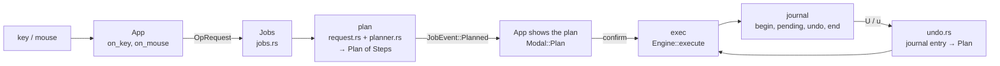

# Architecture

A map of the code for someone opening the repository for the first time. For build and test
commands see [development.md](development.md); for the safety rules see [SAFETY.md](SAFETY.md).

## The three crates

| Crate | What it does |
|---|---|
| `crates/core` (`rada-core`) | Everything that is not a screen. The file model, the plan → execute → journal → undo engine, the background workers, the platform layer. Depends on no interface. |
| `crates/tui` (`rada-tui`) | The terminal interface (ratatui + crossterm). `App` holds the state, `ui/` draws it, `run.rs` is the event loop. Never changes a file itself: it asks `rada-core`. |
| `crates/rada` (`rada`) | The binary. Parses the command line and `config.toml`, detects the terminal, builds `Config` and `Services`, calls `rada_tui::run::run`. Also the installers: desktop entry, shell hook, fonts, `Rada.app`, Windows folder setup. |

## Main flow

Every change to a file goes through the same five steps. No operation skips the plan or the journal.

1. **Input.** `app/input.rs` turns a key into a `keymap::Action` and calls the matching `App` method.
2. **Plan.** `Jobs::plan_request` scans the sources (`ops/scan.rs`) and builds a `Plan`: a list of `Step`s (`MakeDir`, `CopyFile`, `Rename`, `TrashItem`, …). Nothing on disk changes. The `App` shows the plan and waits.
3. **Execute.** After the confirmation, `Jobs::execute` runs the plan on a worker thread (`ops/exec.rs`). Errors ask the person what to do (skip, retry, abort) through `JobEvent::AskFailure`.
4. **Journal.** `ops/runner.rs` wraps the executor. Before a step it writes `pending`; after it, the inverse step. The journal is an append-only JSON-lines file in the state folder. If the journal cannot be written when an operation begins, the operation does not start. If the file could not be opened at launch, rada warns and runs without undo.
5. **Undo.** `ops/undo.rs` reads a journal entry, checks that the disk is still as the entry left it, and builds a new `Plan` made of the inverse steps. That plan runs through the same executor and is journaled too. Redo re-plans the original request.

A program can enter at step 2: `rada --request file.json` builds an `OpRequest` and the confirmation window opens on it. `rada --schema request` prints the JSON Schema.

## Background work

The UI thread does no I/O. Every slow or blocking job runs on a worker thread of `rada-core` and answers on **one** channel of `CoreEvent` (`core/src/events.rs`).

- `Services::start_with` (`tui/src/services.rs`) starts the workers and keeps their senders: `Jobs`, `DirLoader` (two: current folder and its parent), `PreviewWorker`, `SizeWorker`, `DirWatcher`, `VolumesWorker`, `PlacesStore`, plus one-shot threads for git, zoxide, tree and completion lists.
- `run.rs` `select!`s over three inputs: the keyboard (its own thread), the `CoreEvent` channel and image-resize results. A burst of events folds into one frame.
- `App::on_core_event` is the only place where an answer from a worker becomes state. It routes by variant: `Dir`, `Watch`, `Preview`, `Job`, `Volumes`, `Git`, …
- Requests carry a **generation** number. The `App` bumps it on every navigation and drops answers with an older one, so a slow listing of a folder already left cannot overwrite the current one.
- `ui::draw(f, &mut App)` reads only `App` state. It takes `&mut` to store what it learned about the screen (click rectangles in `Hits`, row counts in `Viewport`), never to touch the disk. All file data it shows (`DirListing`, `Preview`, sizes, git status) arrived earlier as an event.
- Known exception: the save-as check of the file chooser stats one path on the UI thread (`app/chooser.rs`). The terminal probes in `termtheme.rs` and `clipboard.rs` run programs, not files.

## Platform code

All OS-dependent behaviour sits behind the `Platform` trait (`core/src/platform/mod.rs`): trash, volumes, file attributes, opening files, path rules, tags, user folders. The rest of the core never tests the OS; it asks the trait.

| Platform | Where |
|---|---|
| Linux | `core/src/platform/linux/` (`devices.rs` phones and sticks, `mounts.rs`, `open.rs`, `fidelity.rs`), `freedesktop.rs` (trash), `unix.rs` |
| Windows | `core/src/platform/windows.rs` (Recycle Bin, drives, reparse points, attributes). Binary side: `rada/src/winsetup.rs`, `winfolder.rs` |
| macOS | `core/src/platform/macos.rs` (Finder trash, volumes, tags, Quick Look), `bplist.rs`, `foldernames.rs`. Binary side: `rada/src/macapp.rs` |
| Shared | `openwith.rs`, `tags.rs`, `launch.rs`, `access.rs` |

`windows.rs` and `macos.rs` are compiled on every OS (the Windows and macOS code is gated with `cfg` inside the file), so Linux can type-check them. `platform::current` picks the implementation; `testplatform.rs` is the fake used by tests.

## Read these first, in this order

1. `crates/core/src/ops/plan.rs` — `Step`, `Plan`, `Step::inverse`. The vocabulary of the engine.
2. `crates/core/src/ops/request.rs` — `OpRequest` and `plan_request`: from a request to a `Plan`.
3. `crates/core/src/ops/exec.rs` — `Engine::execute`, `run_step`, error handling, cancellation.
4. `crates/core/src/journal.rs` — the on-disk record and how it is replayed.
5. `crates/core/src/ops/undo.rs` — journal entry → inverse `Plan`, with the safety checks.
6. `crates/core/src/events.rs` — every message a worker can send. The contract between core and UI.
7. `crates/core/src/jobs.rs` — how plan, execute and undo run on threads and report back.
8. `crates/tui/src/run.rs` — the event loop: terminal setup, `select!`, drawing.
9. `crates/tui/src/app.rs` — the `App` struct, `on_core_event`, `on_job`, `on_modal_key`.
10. `crates/tui/src/ui/mod.rs` — `draw`: how the screen is composed from `App` state.
