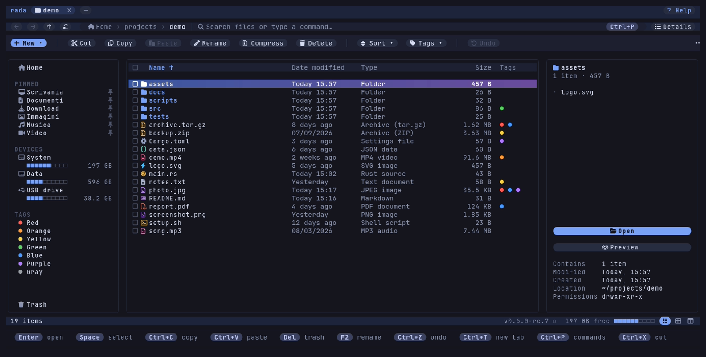
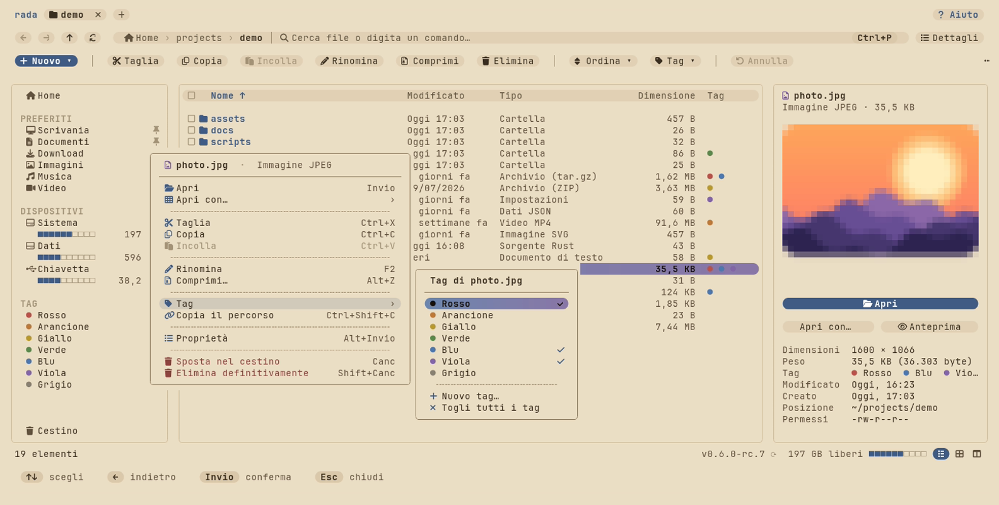
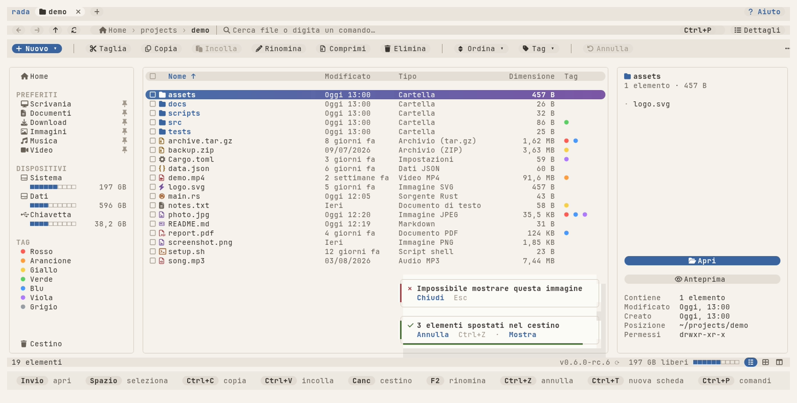
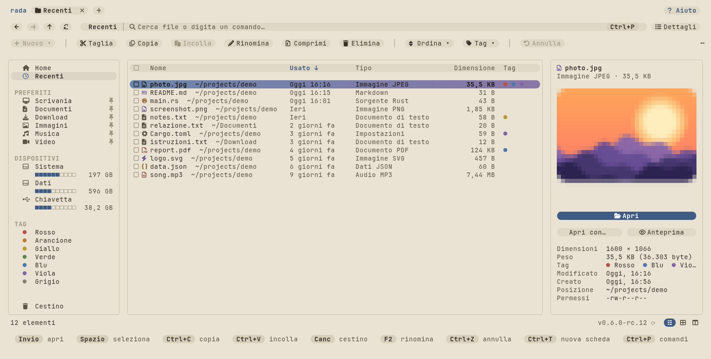

# The interface

One item is selected, two wait on the clipboard, the cursor is on a picture, and the card at the bottom right says the last copy went through, with **Annulla** and **Mostra** one click away. On a light terminal the same screen is "Carta", the paper theme:

The interface speaks **Italian and English** (the screenshots are in Italian); it follows the system, or `language = "it"` / `"en"`. The same screen in English:

The names of the folders in the sidebar are the ones the system gives them (Italian, in these pictures). Everything is drawn with soft shapes — rounded cards, pills, a shade behind the cursor — where the terminal's font has the glyphs for them, and plainly where it has not (see [Terminals](terminals.md)).

| | |
|---|---|
|  |  |
| The **Icons** view: a big icon and the name. | The **Columns** view, as in the Finder: the folder above, the folder here, what is under the cursor; `←` and `→` move between the columns. |
|  |  |
| The menu of the right button, with each action's key. | **Apri con…** lists the programs that can open the file. |
|  |  |
| The **TAG** section of the sidebar and the list of what carries one (*Tag: Blu*). | After a copy, a move, the trash, a rename, a compression, an extraction or a change of tags, a card says what was done, with **Annulla** and **Mostra**; up to three are piled, each with its own six seconds, and a running operation is a card with a progress bar. |
|  |  |
| Every operation shows a **plan** first. | Progress counted in bytes, with throughput and time left. |
|  |  |
| **Eliminare definitivamente** says that nothing goes to the trash and still asks for the typed word. | **Annullare la copia** says what comes back or goes away, line by line. |
|  |  |
| The **Tag** submenu opens beside the menu, which stays in view. | The same on **Carta**, the paper theme. |
|  |  |
| The **basic profile** (`TERM=vt100`): ASCII, 16 colours, `[######----]` for a disk. | A narrow terminal: the sidebar is a column of icons. |

## The screen

From the top: a row of **tabs**, the **bar**, the **command bar**, then the body — three rounded cards: the **navigation pane**, the folder, the **details pane** — a **status bar** and a row of **key hints**. Everything drawn as a button does what its key does, through the same path: a plan first, then your confirmation, then the operation.

### Tabs

`Ctrl+T` opens a tab in the current folder, `Ctrl+W` closes it (the last one is not closed: it goes back to Home), `Ctrl+Tab` / `Ctrl+Shift+Tab` or `Ctrl+PgDn` / `Ctrl+PgUp` switch, `Alt+1` … `Alt+9` jump, a click on a tab switches and a middle click (or its ✕) closes it. Each tab has its own folder, history, cursor, selection, sort order and view; the clipboard, the journal and undo are shared. The open tabs are remembered between sessions (`remember_tabs = false` turns that off); a folder given on the command line opens in a tab of its own beside them. On a narrow terminal the tabs fold into `‹ 2/3 ›`.

### The bar

One pill holds the path and the search. At rest it shows the path as clickable crumbs (`…` folds a long one; click it to pick a hidden folder) and *Cerca file o digita un comando…* with a **Ctrl+P** chip  At the left sit back `‹`, forward `›`, up `↑` and refresh `⟳` (`Alt+←`, `Alt+→`, `Alt+↑`, `F5`; `Backspace` goes back with the classic keys alone and to the parent with the vim keys), at the right the pill of the view (*Colonne*, *Dettagli*, *Icone*).

`Ctrl+P` (`m` in the vim keys), `Ctrl+L`, `Alt+D`, `F4`, `Ctrl+F`, `/` or a click on the pill start typing, and what you type decides what happens:

- a **path** (`~/Documenti`, `/etc`, `../x`): `~` is your home, relative paths start at the current folder, `Tab` completes with the subfolders (listed by a background worker, never while you type), `Enter` goes. `Ctrl+L` selects the old path, so typing replaces it;
- **words**: the files of this folder are filtered as you type (`tag:red` finds by tag), and under the bar the **commands** that match (*Copia*, *Nuova cartella*, *Vista a colonne*…) and the places (folders, recents, pinned, disks) are offered. `↑` `↓` choose, `Enter` runs the one chosen; with none chosen it keeps the filter if files match, otherwise it runs the best command;
- `Esc` goes back to the path and clears the filter; `Backspace` on an empty bar closes it.

### Command bar

**+ New ▾** (a folder or an empty file), **Cut, Copy, Paste, Rename, Compress, Delete**, **Sort ▾**, **Tags ▾** (where the system has tags) and **Undo · copy of 3 items**, which says what the next undo would undo (taken from the journal). A button that cannot be used right now is faint and does nothing. Below 100 columns only the icons stay; the **⋯** at the right has the rest.

### The folder

**Details** shows a checkbox, the icon and name (folders in the accent colour and bold), the date, the type in words and the size; the column titles sort (click again to reverse, an arrow marks the sorted one). A click on a name moves the cursor; the box on the left, or `Space`, selects; double-click or `Enter` opens. The row under the cursor has a shade that goes from one accent to the other, white bold text and rounded ends (on a terminal without true colour or without a Nerd Font it is a solid colour); selected rows have a quiet background, a ticked box and a bold name. The **Tag** column shows the dots of the tags (three at most, then `+2`); *Vista ▾* or `F8` hides it, and it goes by itself when the name would get too little room. Dates are relative ("Today 14:03", "Yesterday", "3 days ago", "2 weeks ago", then the full date in the order your locale uses; `dates = "absolute"` always writes it in full). The size of a **folder** is counted in the background, only for the folders on screen (`···` while it counts, `> 3.2 GB` when it had to stop early): links, other disks, `/proc`, `/sys`, `/dev` and network shares are not entered, and `folder_sizes` (`auto`, `items`, `off`) with `folder_size_seconds` and `folder_size_entries` set how far it goes.

**Icons** shows tiles with a big icon and the name under it, cut with `…`. The arrows and `h` `j` `k` `l` move in two dimensions; selection and every action are the same. Switch with the pill of the view, the buttons at the right of the status bar, `Ctrl+1` / `Ctrl+2` / `Ctrl+3` (if your terminal tells them apart) or `v`.

**Columns** is the Finder's view: the folder above on the left, this folder in the middle, and on the right what is under the cursor (a folder's contents, or the preview of a file). `→` or `l` goes into a folder, `←` or `h` to the folder above. Under 54 columns of width it falls back to the table.

### Notifications

When a copy, a move, the trash, a rename, a compression, an extraction or a change of tags is done, a card appears at the bottom right of the list: *✓ 3 elementi copiati in Documenti*, then *Annulla  Ctrl+Z · Mostra*, both clickable (*Mostra* goes to the folder). Up to three are piled, each with its own six seconds and a bottom edge that shortens as they pass; the list is made shorter while they are there, so they never cover its text. The first key you press goes to the list, and the cards go with it. An operation that is running is a card too, with its progress bar, *42% · 12 MB/s · 3 s* and *Interrompi*. An **error** stays, with a red side, until you close it with `Esc` or a click.

### Details pane

The name with its icon, the type and size, a big preview (pictures, a PDF's first page, text, an archive's contents), then **Open** (full width), **Open with…** and **Preview** (the preview over the whole screen), then the properties: *Dimensions* for pictures, *Size* with the exact bytes, *Modified*, *Created* where the file system keeps it, *Location* and *Permissions*. It is a column from 140 columns; below that `Alt+P` shows it over the right of the list. `Alt+P` toggles it and the choice is remembered.

### Navigation pane

**Home** and, under it, **Recent** (where the system has a list of the files you used lately: see [Recent](interface.md#recent)), then **PINNED** (your standard folders under the names your system really uses — *Scaricati* and *Documenti* on an Italian desktop — and the folders you pin, marked with a pin), **DEVICES** (each disk with a bar of ten segments, `■■■■■■□□□□`, of how full it is, and what is free; `[######----]` in the basic profile; on Linux also phones, cameras and sticks, even when not mounted: see [Phones, cameras and sticks](devices.md)), **TAGS** (the colours and your own tags) and the **Trash**. Pin a folder from the context menu or with `B`; `Del` on a pinned folder (with the keyboard focus on it) unpins it. The folders pinned in the config file (`bookmarks`) can only be unpinned there. The place you are in has a quiet background. The entries stand one column further in than the titles of the groups, which are what sets the groups apart, with a space between an icon and its name; a disk's bar follows the indent of its disk. Blank lines between the entries are off by default: `sidebar_density = "comfortable"` adds them as the height of the terminal allows (a blank line between Home and Recent and two between groups, then after every second entry, then after every entry), and the blank lines are never entries (no click, no arrow lands on them). The column of icons is not changed. `Tab` moves the keyboard into the pane (`↑` `↓`, `Enter` opens, `Tab` or `Esc` leaves). `Ctrl+B` shows or hides it. Below 100 columns it becomes a column of icons (hover or move onto one and its name shows in the status bar), below 60 it goes.

### Recent

Under **Home**, **Recent** lists the files you used lately, the last used first (at most 200), with a **Last used** column in place of *Modified*. It is a list like the one of a tag: you can open, copy and look at its files, but nothing can be made in it. `Enter` opens a file; **Show in folder** (`Alt+F`, or in the menu of the right button) goes to its folder with the cursor on it. Where the list comes from depends on the system, and when there is none the entry is not shown at all:

| System | Source |
|---|---|
| macOS | Spotlight (`mdfind`): what was used in the last 30 days under your home folder, with the date of its last use |
| Linux | `recently-used.xbel` in `~/.local/share` (the file the desktop's programs write), only files that still exist |
| Windows | the shortcuts of your `Recent` folder, read for the file each one points at |

Hidden folders and the Mac's `Library` are left out.

### Status bar and hints

`19 elementi │ ☑ 3 selezionati · 56,7 MB │ ⎘ 2 elementi da incollare` on the left (the screenshots are in Italian; in English, `19 items │ ☑ 3 selected · 56.7 MB │ ⎘ 2 items ready to paste`); on the right the free space of the current disk as a bar of segments and the buttons of the three views. Under it the **hints**: the keys that make sense now, drawn as pills and generated from your real keymap, so they follow `keymap = "vim"` and whatever you rebound. `show_hints = false` hides them; on a short terminal they go first, then the command bar.

### Open with…

`Alt+O` (`O` in the vim keys), the button of the details pane or the context menu. The window lists the **programs installed on the system that can open this kind of file**: the system's choice first (marked *default*), the programs you used lately after it, then the others by name. Type to filter by the words of the name; `↑` `↓` and `Enter` (or a click) start the highlighted one. The last line, **Other program…**, is the free field of a command with its options (`code`, `vlc --fullscreen`; on a Mac an application's name), filled with what you had typed.

- **Linux**: the `.desktop` files of `$XDG_DATA_HOME/applications` and `$XDG_DATA_DIRS` whose `MimeType` fits the file's type (from the shared MIME database, the types it is a kind of included: a Rust file is also a text file) and what `mimeinfo.cache` and `mimeapps.list` add; the default is the one `mimeapps.list` names; hidden entries and those whose program is not installed are left out. A program starts with its `Exec` line, the field codes (`%f %F %u %U %i %c %k`) filled in, in a terminal if it says `Terminal=true`.
- **macOS**: the applications Launch Services knows for the file (asked through `osascript`), the default first; they start with `open -a`.
- **Windows**: the programs the shell associates with the extension (what Explorer's *Open with* lists); they start through the shell, like a double click on that choice.
- **Always use this for this kind of file** (`Tab`, or click the box): rada then opens files of that type with it when you press `Enter`. It is kept **in rada's own state** (`open_with.json`, with the programs used lately) and **never changes the system's defaults**; choosing the program again and unticking the box goes back.

### Context menu

Right click (or `Shift+F10`, or the Menu key). The menu has the name and the type of the item on top, an icon on each entry, its key at the right, groups set apart by a dashed line, and what takes files away in red at the bottom; *Apri con*, *Tag*, *Ordina* and *Nuovo* open a submenu beside it (`→` or `Enter` opens, `←` or `Esc` goes back; entries that are greyed out are skipped). The key bar says which keys work. On an item: Open, Open with…, Cut, Copy, Paste, Rename, Compress…, Extract here / Extract to… on archives, Pin to navigation, Copy path, Delete, Properties. On empty space: New, Paste, Sort by, View, Refresh, Open a terminal here.
